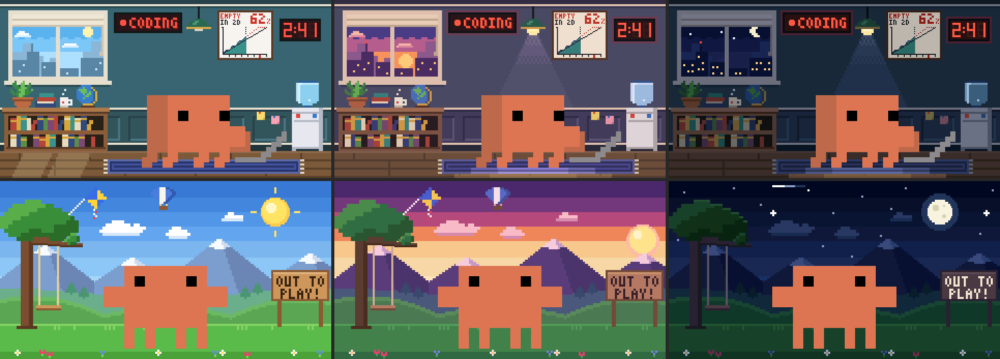
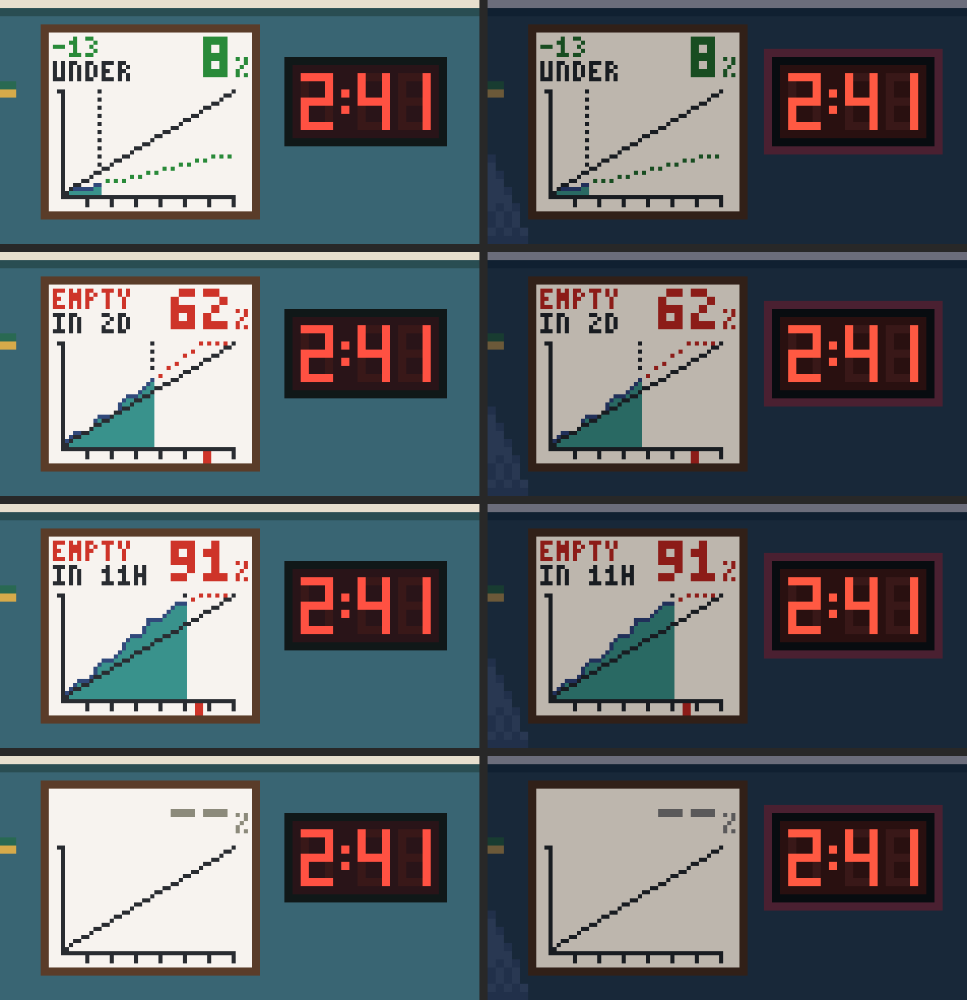
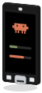

# Clawdmeter

Clawdmeter shows your Claude Code usage limits on an ESP32 development board on your desk. Clawd lives on the device. He reacts to prompts, cheers you on, and alerts you when a session needs your attention.

## This fork (ludwich/Clawdmeter)

Additions on top of upstream, built for a Waveshare ESP32-C6-LCD-1.47. Nothing here is in an upstream PR yet.

**New board: Waveshare ESP32-C6-LCD-1.47 (non-touch)**, env `waveshare_lcd_147_c6_nontouch`.
- ST7789 172×320 over SPI, ESP32-C6 with no PSRAM; BOOT is the only button.
- [Buy link](https://www.waveshare.com/esp32-c6-lcd-1.47.htm?&aff_id=149786).
- Added to the app catalog with its own board art.
- Tested on hardware (ESP32-C6FH8 rev v0.2).

**Clawd works on his laptop while Claude works.**
- The corner Clawd plays the official laptop act while a turn is open, or tools ran in the last minute.
- Long agentic turns stay "working" as long as tools keep running.

**Hook events reach Clawd again.**
- Desktop app v2.2.x marks every hook-event write `rp:1`, and the firmware dropped events on `rp`, so prompts and stops never fired.
- The firmware now fires on any new `es`; `rp` only keeps replayed usage numbers out of the rate math.

**Landscape pages** on boards that can rotate the panel. Opt-in per board via `display_hal_set_landscape()`; today only the LCD-1.47.
- **BOOT:** one press goes to the next page; a double press cycles brightness.
- **Pages:** meters → Clawd page → large usage bars.

**The Clawd page: office or outside.**
- **Office** while Claude works: Clawd at his laptop.
- **Outside** while he plays: walking, skating, ball games.
- **Transition:** blinds close and open between the two scenes.
- **Time of day:** the scenery re-colours for day, dusk and night (from the app's clock).
- **Moods:** a yelling speech bubble on an alert; an anger mark and steam when usage burns fast.

**Live office wall.**
- **LED countdown:** time left until the next 5-hour window (H:MM).
- **Weekly usage poster:**
  - % of the week used, coloured by pace.
  - A verdict: `-13 UNDER`, `ON PACE`, `+3 OVER`, or `EMPTY IN 2D` when your current rate runs out before the reset.
  - A burn-up chart of usage against the even-pace line, with a projection.
  - The device records hourly samples in NVS, so the curve fills in over the week.

Scenery is pixel art authored in Python (`tools/scenes/`). `scenekit.py` generates const C tables (flash only, a few hundred bytes of RAM) and preview PNGs from the same data; see `tools/README.md`.

**Serial QA on the device:**

| Command | What it does |
| --- | --- |
| `page <n>` | Show page `n`: 0 meters, 1 Clawd, 2 usage |
| `work 1\|0\|-1` | Force office (1) or outside (0); `-1` = the real state |
| `tod <minute>` | Force the time of day, e.g. `tod 1380` for night; `-1` = the real clock |
| `mood <bits>` | Force moods: 1 angry, 2 yelling, 0 = the real cues |

**Docs:**
- `docs/clawd-director.md`: the Pages section.
- `docs/porting/hal-contract.md` and `capability-flags.md`: landscape pages are opt-in per board.

## Supported boards

### Flagship

The reference board: everything is developed and tested on it first.

|                                                                                                        | Board                                                                                                           |                                                                                               |
| :----------------------------------------------------------------------------------------------------: | --------------------------------------------------------------------------------------------------------------- | --------------------------------------------------------------------------------------------- |
|     | [Waveshare ESP32-S3-Touch-AMOLED-2.16](https://www.waveshare.com/esp32-s3-touch-amoled-2.16.htm?&aff_id=149786) | 480×480 AMOLED, 3 buttons, speaker. Original board.                                           |

### Stable

Supported on every release.

|                                                                                                        | Board                                                                                                           |                                                                                               |
| :----------------------------------------------------------------------------------------------------: | --------------------------------------------------------------------------------------------------------------- | --------------------------------------------------------------------------------------------- |
|  | [Waveshare ESP32-C6-Touch-AMOLED-2.16](https://www.waveshare.com/esp32-c6-touch-amoled-2.16.htm?&aff_id=149786) | 480×480 AMOLED on the ESP32-C6 (no PSRAM; animated corner Clawd, text-only attention alerts). |
|      | [Waveshare ESP32-S3-Touch-AMOLED-1.8](https://www.waveshare.com/esp32-s3-touch-amoled-1.8.htm?&aff_id=149786)   | 368×448 AMOLED, 2 buttons, speaker.                                                           |
|   | [Waveshare ESP32-C6-Touch-AMOLED-1.8](https://www.waveshare.com/esp32-c6-touch-amoled-1.8.htm?&aff_id=149786)   | 368×448 AMOLED on the ESP32-C6.                                                               |
|     | [Waveshare ESP32-S3-Touch-AMOLED-2.06](https://www.waveshare.com/esp32-s3-touch-amoled-2.06.htm?&aff_id=149786) | 410×502 AMOLED in a watch case.                                                               |
|        | [Waveshare ESP32-S3-Touch-LCD-1.54](https://www.waveshare.com/esp32-s3-lcd-1.54.htm?sku=33869&aff_id=149786)    | 240×240 IPS, 3 buttons, speaker. Smallest supported display.                                  |
|          | [Waveshare ESP32-S3-Touch-LCD-4](https://www.waveshare.com/esp32-s3-touch-lcd-4.htm?&aff_id=149786)             | 480×480 IPS, 4 inches, one button.                                                            |
|  | [LILYGO T4-S3](https://lilygo.cc/products/t4-s3) | 450×600 AMOLED, one button (BOOT; long-hold cycles brightness / scene). |

### Experimental

Ports contributed by the community. Expect rough edges: bugs, or a layout
that isn't optimal for the panel. If something is off, fix it and open a PR.
If everything works, tell us in the
[Board support reports](https://github.com/HermannBjorgvin/Clawdmeter/discussions/222)
discussion (env name, firmware version, a photo) and we'll move the board to
Stable.

|                                                                                                        | Board                                                                                                           |                                                                                               |
| :----------------------------------------------------------------------------------------------------: | --------------------------------------------------------------------------------------------------------------- | --------------------------------------------------------------------------------------------- |
|  | [Waveshare ESP32-S3-Touch-LCD-1.83](https://www.waveshare.com/esp32-s3-touch-lcd-1.83.htm?&aff_id=149786) | 240×284 IPS SPI TFT, BOOT + PWR buttons, rounded watch-style case. |
|  | [Guition ESP32-S3-4848S040 (4-inch 480×480)](https://www.aliexpress.com/item/3256806115962222.html) | 480×480 ST7701S RGB panel, GT911 touch, no buttons. Pair from the computer. |
|  | [Waveshare ESP32-S3-Touch-AMOLED-1.43](https://www.waveshare.com/esp32-s3-touch-amoled-1.43.htm?&aff_id=149786) | 466×466 round AMOLED. BOOT is the only button (push-to-talk); pair by touch hold. |
|  | [Waveshare ESP32-S3-Touch-AMOLED-1.32](https://www.waveshare.com/esp32-s3-touch-amoled-1.32.htm?&aff_id=149786) | 466×466 round AMOLED. BOOT rotates the UI; no HID buttons. |
|  | [ESP32-2432S024C Cheap Yellow Display (portrait)](https://www.amazon.com/dp/B0CLGD2DG6) | 240×320 ST7789, CST820 capacitive touch, classic ESP32 without PSRAM. One button (BOOT = PWR role: brightness, hold to pair). Env `esp32_2432s024c` (portrait) or `esp32_2432s024c_landscape` (320×240). |
|  | [ESP32-2432S028R "Cheap Yellow Display"](https://www.amazon.com/dp/B0BVFXR313) | 240×320 ILI9341, XPT2046 resistive touch, classic ESP32 without PSRAM. One button (BOOT = PWR role: brightness, hold to pair). Env `esp32_2432s028r` (portrait) or `esp32_2432s028r_landscape` (320×240). |
|  | [M5Stack M5StickS3](https://shop.m5stack.com/products/m5sticks3-esp32s3-mini-iot-dev-kit) | 135×240 ST7789P3 stick, no touch, speaker. BtnA is Space/voice, BtnB is PWR. |
|  | [M5Stack FIRE IoT Development Kit (PSRAM) V2.7](https://shop.m5stack.com/products/m5stack-fire-iot-development-kit-psram-v2-7) | 320×240 IPS, classic ESP32 with PSRAM, no touch screen: A = Space, C = Shift+Tab, B = PWR (brightness, hold to pair). |
|  | [LILYGO T-Display S3](https://lilygo.cc/products/t-display-s3) | 170×320 IPS TFT, no touch. BOOT is push-to-talk, the second button (IO14) is the PWR role. |
|  | [Waveshare ESP32-S3-Touch-LCD-2](https://www.waveshare.com/esp32-s3-touch-lcd-2.htm?&aff_id=149786) | 240×320 IPS, 2 inches, touch-only (no usable buttons). |
|  | [Waveshare ESP32-S3-ePaper-1.54](https://www.waveshare.com/esp32-s3-epaper-1.54.htm?&aff_id=149786) | 200×200 black-and-white e-paper, no touch. Minimal UI, slow partial refresh. |
|  | [Xingzhi Cube 1.83 inch TFT WiFi (2-mic)](https://www.aliexpress.com/item/1005010442374066.html) | 284×240 landscape TFT, no touch, 3 buttons. Vendor init table on the ST7789 driver. |
|  | [Freenove ESP32-S3 Display 2.8 inch (non-touch, FNK0104A)](https://store.freenove.com/products/fnk0104) | 240×320 IPS, no touch. Minimal UI: meters and a still Clawd; BOOT: brightness, hold to pair. |
|  | [Seeed Studio SenseCAP Indicator D1L](https://www.seeedstudio.com/SenseCAP-Indicator-D1L-p-5646.html) | 480×480 RGB touch screen. Side button: brightness / hold to pair; no HID buttons or sound. |
|  | [SpotPear ESP32-S3-LCD-1.54 MUMA (touch)](https://spotpear.com/shop/ESP32-S3-AI-1.54-inch-LCD-Display-TouchScreen-N16R8-muma-DeepSeek.html) | 240×240 ST7789 SPI LCD, CST816 touch, no PMU. BOOT is the only button. |
|  | [Waveshare ESP32-C6-LCD-1.47 (non-touch)](https://www.waveshare.com/esp32-c6-lcd-1.47.htm?&aff_id=149786) | 172×320 ST7789 SPI TFT on the ESP32-C6 (no PSRAM), no touch. BOOT is the only button: brightness, hold to pair. |

## Install

Download the app from the [latest release](https://github.com/HermannBjorgvin/Clawdmeter/releases/latest).

| OS             | Package     | Install                                                                                                                          |
| -------------- | ----------- | -------------------------------------------------------------------------------------------------------------------------------- |
| macOS          | `.dmg`      | Drag Clawdmeter to Applications. If blocked, use **System Settings → Privacy & Security → Open Anyway**. Allow Bluetooth access. |
| Windows        | `.msi`      | Run the installer. If SmartScreen blocks it, choose **More info → Run anyway**.                                                  |
| Debian, Ubuntu | `.deb`      | `sudo apt install ./clawdmeter_<version>_amd64.deb`                                                                              |
| Other Linux    | `.AppImage` | `chmod +x clawdmeter-*.AppImage`, then run it.                                                                                   |
| NixOS, Nix     | Flake       | `nix run github:HermannBjorgvin/Clawdmeter`                                                                                      |

The macOS and Windows packages aren't signed with a publisher certificate.
See the [user guide](docs/user-guide.md#installation) for Linux requirements,
portable archives, and Nix setup.

## Quick start

1. Launch Clawdmeter and follow setup. Connect the board with a USB data
   cable, check the selected board, and install firmware.
2. Pair **Clawdmeter** in your computer's Bluetooth settings. It appears as
   a keyboard because its buttons send key presses.
3. Open **Hooks** to let Clawd react to Claude Code activity and alert when
   a session needs an answer. Review the changes before saving.
   Usage meters work without hooks.
4. Enable **Settings → Start at login** if you want the app to launch when
   you sign in.

## Docs

- [User guide](docs/user-guide.md): setup, device controls, settings, and connection help.
- [Development](docs/development.md): builds, simulator, and releases.
- [Add a board](docs/porting/adding-a-board.md): hardware ports and app integration.
- [BLE protocol](docs/protocol.md): payload fields and notifications.
- [Clawd's director](docs/clawd-director.md): behavior and character rules.
- [Legacy daemon parity](docs/daemon-parity.md): upgrade steps and implementation differences.

## Licensing gray area warning

The software in this repository uses and adheres to the Anthropic brand guidelines and uses the same proprietary fonts that Anthropic has a license for but this software uses without permission as well as using assets from Anthropic such as the copyrighted Clawd mascot so even though the code in this repo is non-proprietary I will not license it myself under a copyleft license since this repo includes proprietary fonts and copyrighted assets. Please be aware of this if you fork or copy the code from this repo. **You have been warned!**
